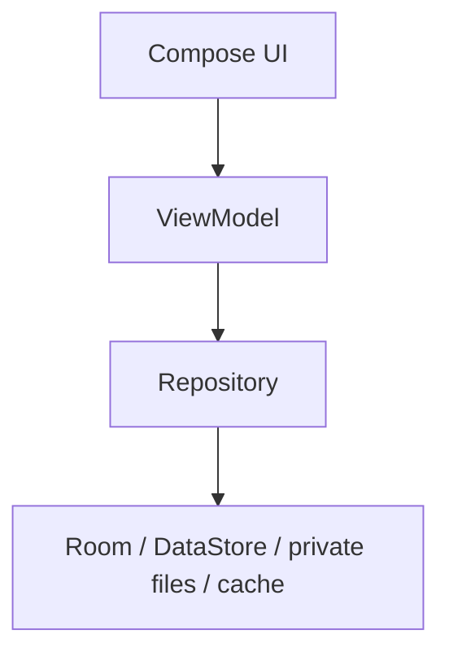

# MyNotes

MyNotes is an Android notes application built primarily with **Kotlin + Jetpack Compose**. It focuses on flexible note organization, multimedia attachments, rich link previews, extensive visual customization, adaptive performance profiles, audio feedback, backup/restore, and compatibility starting from Android 7.0.

## Contents

- [Screenshots](#screenshots)
- [Features](#features)
- [Technical overview](#technical-overview)
- [Architecture](#architecture)
- [Data and storage](#data-and-storage)
- [Performance profiles](#performance-profiles)
- [Android integration](#android-integration)
- [Development](#development)
- [Support the project](#support-the-project)
- [Authorship and credits](#authorship-and-credits)
- [Copyright and license](#copyright-and-license)

## Screenshots

The screenshots below are stored inside [`doc/images/`](doc/images/) so the repository documentation remains self-contained.

<table>
  <tr>
    <td align="center"><strong>Home screen</strong></td>
    <td align="center"><strong>Note editor</strong></td>
  </tr>
  <tr>
    <td align="center"></td>
    <td align="center"></td>
  </tr>
  <tr>
    <td align="center"><strong>Color palette settings</strong></td>
    <td align="center"><strong>Note options menu</strong></td>
  </tr>
  <tr>
    <td align="center"></td>
    <td align="center"></td>
  </tr>
</table>

## Features

### Notes and organization

- Create, edit, delete, pin, prioritize, and favorite notes.
- Organize notes by categories and filters.
- Search notes from the main screen.

### Appearance and personalization

- One-, two-, and three-column layouts.
- Per-note colors and global color palettes.
- Configurable fonts, light/dark appearance, panel intensity, icons, menus, buttons, and visual effects.

### Media and feedback

- Image, video, audio, voice-recording, document, PDF, text, and generic file attachments.
- Link previews for supported web content and social platforms.
- Configurable UI sounds and vibration patterns.

### Backup and developer tools

- Backup and restore support.
- XML preview layouts under `app/src/main/res/layout/` for studying the Compose UI from Android Studio Design / Split view.
- A development-information section inside the application with architecture, technology, authorship, source-code, repository, copyright, and performance information.

## Technical overview

### Project status

| Setting | Value |
| --- | --- |
| Application | `MyNotes` |
| Package / application ID | `com.example.mynotes` |
| Version | `1.0` |
| Version code | `1` |
| `minSdk` | **24** — Android 7.0+ |
| `targetSdk` | **36** |
| `compileSdk` | **37** |
| Java compatibility | **11** |
| UI | **Jetpack Compose + Material 3** |
| Build system | **Gradle Kotlin DSL + KSP** |
| Release configuration | code minification and resource shrinking enabled |

### Technology stack

| Technology | Version, when specified |
| --- | --- |
| Kotlin | — |
| Jetpack Compose | — |
| Material 3 | — |
| Room | `2.7.2` |
| KSP | — |
| DataStore Preferences | `1.1.7` |
| Coil | `3.3.0` |
| Media3 / ExoPlayer | `1.11.0` |
| Lifecycle Runtime Compose | `2.11.0` |
| AppCompat | `1.7.1` |
| Kotlin Coroutines | — |
| AndroidX | — |

## Architecture

The project follows a responsibility-oriented architecture:



`MainActivity` coordinates Compose navigation and system/UI policies. ViewModels expose state and user actions. Repositories centralize persistence and data-related behavior. Room stores notes and attachment metadata, while DataStore stores user-configurable preferences.

## Data and storage

- Notes are stored locally with Room.
- Attachments are copied into the application's private storage.
- `AttachmentPreviewCache` generates and reuses attachment thumbnails through RAM and disk caching.
- Cached thumbnails are disposable and can be regenerated if Android clears the cache.
- Link-preview data is handled separately so network or metadata processing does not block the main UI.
- Maximum-quality mode includes progressive and prewarmed thumbnail strategies to reduce visible image pop-in during fast scrolling.

## Performance profiles

| Setting | Maximum performance | Balanced | Maximum quality |
| --- | --- | --- | --- |
| Requested refresh rate | 60 Hz | 60 Hz | Up to 120 Hz, when supported |
| Image previews | Up to 360 px | Up to 720 px | Up to 1280 px |
| Video previews | Up to 360 px | Up to 720 px | Up to 1080 px |
| Audio artwork | 256 px | 512 px | 768 px |
| PDF previews | 480 px | 960 px | 1440 px |

**Maximum performance:** Prioritizes lower CPU, memory, I/O, and decoding workload.

**Maximum quality:** Uses prewarming, progressive caching, and scroll-aware loading to reduce visible thumbnail pop-in.

> Refresh rates are requests to Android. The platform can select a different mode if the panel, compositor, or current system conditions do not provide the requested refresh rate.

## Android integration

### Permissions

| Permission | Purpose |
| --- | --- |
| `INTERNET` | remote link-preview resources. |
| `RECORD_AUDIO` | voice-note recording. |
| `VIBRATE` | configurable haptic feedback. |
| `MODIFY_AUDIO_SETTINGS` | temporarily suppressing system keyboard-click audio while preserving MyNotes UI sounds when that feature is active. |

### Platform features

- The microphone is declared as optional hardware.
- `FileProvider` is used for secure file sharing.
- `ACTION_SEND` allows shared text from other applications to be turned into a note.
- Edge-to-edge / immersive UI handling.
- Compose rendering is synchronized through Android's normal Choreographer / VSYNC pipeline.

## Development

### Repository

- GitHub: [lxxsnowxxl/Mynotes](https://github.com/lxxsnowxxl/Mynotes)
- Main account: [@lxxsnowxxl](https://github.com/lxxsnowxxl)
- Main branch: `main`

### Important source files

<details>
<summary>Browse the main source files</summary>

```text
app/src/main/java/com/example/mynotes/MainActivity.kt
app/src/main/java/com/example/mynotes/viewmodel/NoteViewModel.kt
app/src/main/java/com/example/mynotes/viewmodel/SettingsViewModel.kt
app/src/main/java/com/example/mynotes/ui/theme/NotesScreen.kt
app/src/main/java/com/example/mynotes/ui/theme/NoteEditorScreen.kt
app/src/main/java/com/example/mynotes/ui/theme/NoteDetailScreen.kt
app/src/main/java/com/example/mynotes/ui/theme/SettingsScreen.kt
app/src/main/java/com/example/mynotes/ui/theme/DevelopmentInfoScreen.kt
app/src/main/java/com/example/mynotes/ui/theme/SourceCodeInfoScreen.kt
app/src/main/java/com/example/mynotes/ui/components/NoteCard.kt
app/src/main/java/com/example/mynotes/performance/AttachmentPreviewCache.kt
app/src/main/java/com/example/mynotes/performance/DisplayPerformanceController.kt
app/src/main/java/com/example/mynotes/links/LinkPreviewRepository.kt
app/src/main/java/com/example/mynotes/settings/SettingsRepository.kt
```

</details>

### Documentation

Source documentation is available in the following locations:

- [`doc/`](doc/) — extremely detailed documentation covering variables, parameters, restrictions, scopes, callbacks, side effects, lifecycle behavior, state, caching, concurrency, Android APIs, and internal relationships.

Additional references include:

- [`DEVELOPMENT.md`](DEVELOPMENT.md)
- [`LAYOUT_PREVIEWS_ANDROID_STUDIO.md`](LAYOUT_PREVIEWS_ANDROID_STUDIO.md)
- `CAMBIOS_*.md` / `CAMBIOS_*.txt` implementation notes
- XML preview layouts under `app/src/main/res/layout/`

### Building the project

1. Clone the repository:

   ```bash
   git clone https://github.com/lxxsnowxxl/Mynotes.git
   ```

2. Open the project in Android Studio.
3. Configure the Android SDK locally. `local.properties` must remain local and should not be committed.
4. Sync Gradle.
5. Build and run the app from Android Studio, or use the project's Gradle wrapper.

### Repository hygiene

The root `.gitignore` excludes common local/generated Android files such as:

<details>
<summary>View ignored local and generated files</summary>

```text
.gradle/
.idea/
local.properties
build/
app/build/
*.apk
*.aab
*.jks
*.keystore
keystore.properties
secrets.properties
```

</details>

Review staged files before each public push, especially when local credentials, signing files, exports, or test data have been added to the workspace.

## Support the project

If MyNotes is useful to you, consider supporting its development with a voluntary contribution.

[Support MyNotes via PayPal](https://paypal.me/ttsnowtt?locale.x=es_XC&country.x=MX)

Thank you for your support!

## Authorship and credits

- **Primary development:** Snow
- **Technical development assistance:** OpenAI ChatGPT

OpenAI ChatGPT has been used for code review, documentation, performance analysis, debugging support, and development assistance. The project's direction and primary authorship remain with Snow.

## Copyright and license

© 2026 Snow · MyNotes

This repository currently does **not** include a `LICENSE` file, so no specific open-source license is granted by the repository itself. Android, Kotlin, Jetpack Compose, Material, Coil, Media3, and all other third-party libraries, trademarks, and assets remain subject to their respective owners and licenses.
