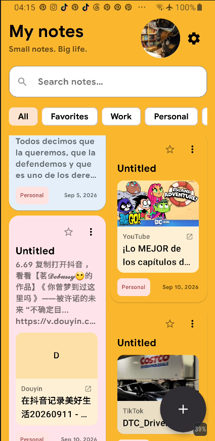
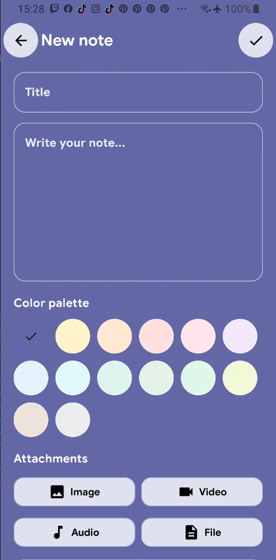
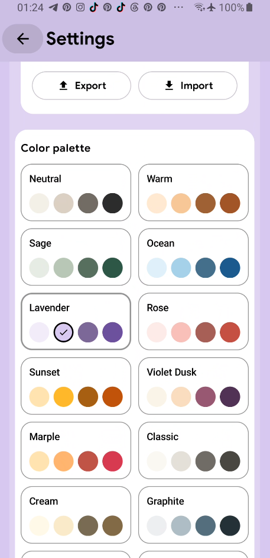
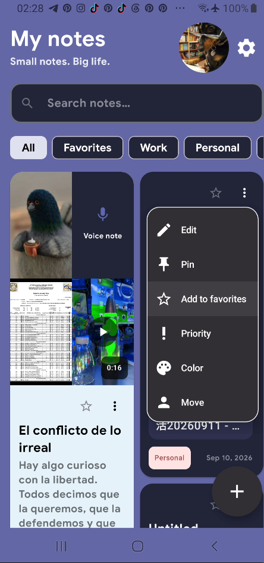
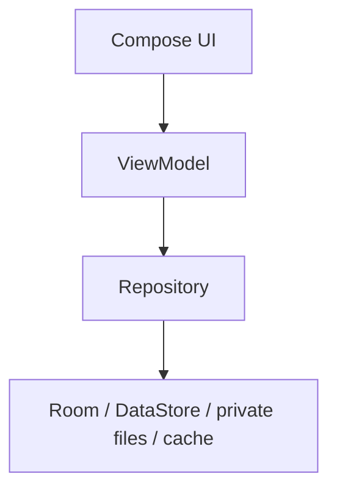

# MyNotes

MyNotes is an Android notes application built with **Kotlin, Jetpack Compose, and Material 3**. It combines note organization, multimedia attachments, reminders, home-screen widgets, drawing and PDF tools, manual backups, and extensive appearance controls. It supports **Android 7.0 (API 24) and later**.

**[APK downloads and releases](https://github.com/lxxsnowxxl/Mynotes/releases) · [Source code](https://github.com/lxxsnowxxl/Mynotes) · [Support the project](#support-the-project)**

## Contents

- [Screenshots](#screenshots)
- [Features](#features)
- [Technical overview](#technical-overview)
- [Architecture](#architecture)
- [Data and storage](#data-and-storage)
- [Performance profiles](#performance-profiles)
- [Android integration](#android-integration)
- [Development](#development)
- [Support the project](#support-the-project)
- [Authorship and credits](#authorship-and-credits)
- [Copyright and license](#copyright-and-license)

## Screenshots

The screenshots below are stored inside [`doc/images/`](doc/images/) so the repository documentation remains self-contained.

<table>
  <tr>
    <td align="center"><strong>Home screen</strong></td>
    <td align="center"><strong>Note editor</strong></td>
  </tr>
  <tr>
    <td align="center"></td>
    <td align="center"></td>
  </tr>
  <tr>
    <td align="center"><strong>Color palette settings</strong></td>
    <td align="center"><strong>Note options menu</strong></td>
  </tr>
  <tr>
    <td align="center"></td>
    <td align="center"></td>
  </tr>
</table>

## Features

### Notes and organization

- Create, edit, delete, pin, prioritize, and favorite notes.
- Organize notes by categories and filters, and search from the home screen.
- Use responsive one-, two-, or three-column layouts, depending on available width.

### Appearance and configuration

- Choose from **23 visible color families**, with five selectable tones per family. Previously saved palettes remain supported.
- Apply **Solid, Gradient, or Blur-style backgrounds** across app screens. Blur-style backgrounds use soft radial gradients while text and controls remain sharp.
- Select **Basic mode** for essential settings and a light theme, or **Advanced mode** for full customization and optional dark mode.
- Customize fonts, panel intensity, icons, note cards, menus, sliders, animations, and buttons.
- Change and crop the profile photo. The avatar resizes around a fixed center while adjacent buttons keep their proportions and position.

### Media and feedback

- Attach images, videos, audio, voice recordings, documents, PDFs, text files, and other files.
- View attachments in dedicated viewers and load link previews for supported web content.
- Adjust UI sound effects and reminder sounds with **independent volume controls**.
- Configure haptic feedback styles and intensity.

### Reminders and widgets

- Schedule local reminders with repeat options, notifications, sounds, and haptic feedback.
- Reschedule enabled reminders after device restart or an application update.
- Add **Quick Note, Recent Notes, Favorites, and Focus Note** home-screen widgets.

### Drawing and PDF tools

- Create drawings using the built-in canvas.
- Use **PDF Studio** to create, edit, save, and export PDF projects, including text and images.
- Use image cropping and optional subject segmentation through Google ML Kit. The segmentation feature depends on Google Play services and model availability.

### Backup, updates, and developer tools

- Export and restore **manual ZIP backups** containing notes, attachments, application settings, and the profile image when available.
- Check GitHub Releases for updates and use Android's installer to install a downloaded APK.
- Inspect application, platform, architecture, and source-code information in the in-app development section.
- Work with editable XML layout references and matching Compose preview entry points.

## Technical overview

### Project status

| Setting | Value |
| --- | --- |
| Application | `MyNotes` |
| Package / application ID | `com.example.mynotes` |
| Published versions and APKs | [GitHub Releases](https://github.com/lxxsnowxxl/Mynotes/releases) |
| APK version and build number | `versionName` and `versionCode` in [`app/build.gradle.kts`](app/build.gradle.kts) |
| `minSdk` | **24** — Android 7.0+ |
| `targetSdk` | **36** |
| `compileSdk` | **37** |
| Java source / target compatibility | **11** |
| UI | **Jetpack Compose + Material 3** |
| Build system | **Gradle Kotlin DSL + KSP** |
| Release optimization | Code minification and resource shrinking enabled |
| License | [MyNotes Proprietary Software License](LICENSE) |

GitHub release tags and Android package versions are maintained separately. Refer to Releases for published APKs and to `app/build.gradle.kts` for the version packaged when building from source.

### Technology stack

| Technology | Configured version |
| --- | --- |
| Kotlin | Project-managed |
| Jetpack Compose / Material 3 | Compose BOM / project-managed |
| KSP | Project-managed |
| Room | `2.7.2` |
| DataStore Preferences | `1.1.7` |
| Coil — Compose, network, and GIF support | `3.3.0` |
| Media3 — ExoPlayer and UI | `1.11.0` |
| Lifecycle Runtime Compose | `2.11.0` |
| AppCompat | `1.7.1` |
| ML Kit Subject Segmentation | `16.0.0-beta1` |
| Google Play services base | `18.11.0` |
| Gradle wrapper | `9.3.0` |
| Kotlin Coroutines / other AndroidX components | Project-managed |

Dependency versions reflect the build configuration. Project-managed entries are resolved through Gradle aliases, dependency constraints, or the Compose BOM.

## Architecture

The main note and Settings flows use the following structure:



`MainActivity` coordinates Compose navigation and system/UI policies. ViewModels expose state and user actions. Repositories centralize persistence and data-related behavior. Room stores notes and attachment metadata, while DataStore stores user-configurable preferences.

Reminders use their own repository and scheduler. PDF Studio and attachment viewing have dedicated activities and supporting repositories.

## Data and storage

- Notes and attachment metadata are stored locally with Room.
- Application settings are stored with DataStore Preferences; reminders use their own local SharedPreferences store.
- Attachments and profile images use the application's private storage. PDF Studio keeps saved projects in its own private project directory.
- `AttachmentPreviewCache` reuses thumbnails through RAM and disk caching. Disposable cached thumbnails can be regenerated.
- Link-preview fetching and metadata processing use a separate repository.
- Manual backup ZIPs export notes, attachments, application settings, and the profile image when available. Exported ZIPs are separate from the application's private data.
- The manifest sets `allowBackup="false"`, and backup/extraction rules exclude application data from automatic Android backup. Manual ZIP backup and restore remain available.

## Performance profiles

The default performance profile is **Balanced**. The configured preview sizes and requested refresh rates are:

| Setting | Maximum performance | Balanced | Maximum quality |
| --- | --- | --- | --- |
| Requested refresh rate | 60 Hz | 60 Hz | Up to 120 Hz, when supported |
| Image previews | Up to 360 px | Up to 720 px | Up to 1280 px |
| Video previews | Up to 360 px | Up to 720 px | Up to 1080 px |
| Audio artwork | 256 px | 512 px | 768 px |
| PDF previews | 480 px | 960 px | 1440 px |

**Maximum performance:** Prioritizes lower CPU, memory, I/O, and decoding workload.

**Maximum quality:** Uses prewarming, progressive caching, and scroll-aware loading to reduce visible thumbnail pop-in.

> These are configuration targets, not benchmark results. Refresh rates are requests to Android. The platform can select a different mode if the panel, compositor, or current system conditions do not provide the requested refresh rate.

## Android integration

### Permissions

| Permission | Purpose |
| --- | --- |
| `INTERNET` | Fetch link previews, check releases, and download update or model resources. |
| `ACCESS_NETWORK_STATE` | Check network availability before optional model downloads. |
| `RECORD_AUDIO` | Record voice notes. |
| `VIBRATE` | Provide UI and reminder haptic feedback. |
| `POST_NOTIFICATIONS` | Display reminder notifications when permission is required. |
| `RECEIVE_BOOT_COMPLETED` | Reschedule reminders after the device restarts. |
| `MODIFY_AUDIO_SETTINGS` | Manage audio feedback and temporarily suppress keyboard/system clicks when that feature is active. |
| `REQUEST_INSTALL_PACKAGES` | Hand downloaded update APKs to the Android installer, subject to system authorization. |

### Platform features

- The microphone is optional hardware; the app remains available on devices without one.
- `FileProvider` shares files using content URIs.
- `ACTION_SEND` accepts shared text from other applications for note creation.
- Dedicated activities support attachment viewing and PDF workflows.
- The app includes edge-to-edge / immersive UI handling and normal Android frame scheduling.

## Development

### Repository

- GitHub: [lxxsnowxxl/Mynotes](https://github.com/lxxsnowxxl/Mynotes)
- Main account: [@lxxsnowxxl](https://github.com/lxxsnowxxl)
- Main branch: `main`
- Releases and APK downloads: [GitHub Releases](https://github.com/lxxsnowxxl/Mynotes/releases)

### Important source files

<details>
<summary>Browse the main source files</summary>

```text
app/src/main/java/com/example/mynotes/MainActivity.kt
app/src/main/java/com/example/mynotes/viewmodel/NoteViewModel.kt
app/src/main/java/com/example/mynotes/viewmodel/SettingsViewModel.kt
app/src/main/java/com/example/mynotes/ui/theme/NotesScreen.kt
app/src/main/java/com/example/mynotes/ui/theme/NoteEditorScreen.kt
app/src/main/java/com/example/mynotes/ui/theme/NoteDetailScreen.kt
app/src/main/java/com/example/mynotes/ui/theme/SettingsScreen.kt
app/src/main/java/com/example/mynotes/ui/components/AppBackground.kt
app/src/main/java/com/example/mynotes/ui/components/SettingsBackground.kt
app/src/main/java/com/example/mynotes/ui/components/ProfileImageEditorDialog.kt
app/src/main/java/com/example/mynotes/ui/theme/DevelopmentInfoScreen.kt
app/src/main/java/com/example/mynotes/ui/theme/SourceCodeInfoScreen.kt
app/src/main/java/com/example/mynotes/ui/components/NoteCard.kt
app/src/main/java/com/example/mynotes/performance/AttachmentPreviewCache.kt
app/src/main/java/com/example/mynotes/performance/DisplayPerformanceController.kt
app/src/main/java/com/example/mynotes/links/LinkPreviewRepository.kt
app/src/main/java/com/example/mynotes/settings/SettingsRepository.kt
app/src/main/java/com/example/mynotes/reminders/ReminderRepository.kt
app/src/main/java/com/example/mynotes/reminders/ReminderAlarmScheduler.kt
app/src/main/java/com/example/mynotes/widget/MyNotesWidgetUpdater.kt
app/src/main/java/com/example/mynotes/ui/pdf/PdfEditorActivity.kt
app/src/main/java/com/example/mynotes/ui/pdf/PdfProjectRepository.kt
app/src/main/java/com/example/mynotes/update/GitHubUpdateManager.kt
app/src/main/java/com/example/mynotes/data/AppDataBackupManager.kt
```

</details>

### Documentation

- [Documentation index](doc/00_INDICE.md)
- [Native XML layout references](doc/LAYOUTS_XML_V268.md)
- [XML / Compose screen mapping](doc/layout_compose_previews.json)
- [Global background implementation](doc/FONDO_GLOBAL_V270.md)
- [Profile and background performance review](doc/REVISION_RENDIMIENTO_V276.md)
- [Note action-bar background correction](CAMBIOS_v277_BARRA_INFERIOR_NOTAS.md)
- [Third-party notices](THIRD_PARTY_NOTICES.md)

The `doc/` directory also contains detailed source explanations and revision notes. Use the source files and screen mapping when checking current behavior.

### XML layouts and Compose previews

There are **53 editable XML screen/state references** plus **1 width-specific variant** under `app/src/main/res/layout*/`. The comparison entry points are in `app/src/debug/java/com/example/mynotes/preview/LayoutPreviews.kt`.

In-app screens use Compose at runtime. The `preview_*.xml` files are native Android layout references, maintained alongside Compose; they are not runtime replacements for those screens. Home-screen widgets and custom reminder notifications use their own functional XML resources.

### Building the project

1. Clone the repository:

   ```bash
   git clone https://github.com/lxxsnowxxl/Mynotes.git
   ```

2. Open the complete Android project root in Android Studio, including its settings, dependency/plugin configuration, and Gradle wrapper.
3. Install the Android SDK required by `compileSdk` in `app/build.gradle.kts`. Keep `local.properties` local.
4. Use a JDK compatible with the project's Gradle and Android Gradle Plugin versions. **Java 11 is the source/target compatibility level, not a statement of the build JDK requirement.**
5. Sync Gradle, then build and run from Android Studio or the project wrapper. Use a local signing configuration when generating a release APK.
6. Before publishing, align `versionName` and `versionCode` in `app/build.gradle.kts` with the intended APK release.

### Repository hygiene

Keep local settings, generated output, and signing credentials out of version control. Recommended exclusions include:

<details>
<summary>View recommended local exclusions</summary>

```text
.gradle/
.idea/
local.properties
build/
app/build/
*.apk
*.aab
*.jks
*.keystore
keystore.properties
secrets.properties
```

</details>

Review staged files before each public push, especially when local credentials, signing files, exports, or test data have been added to the workspace.

## Support the project

If MyNotes is useful to you, consider supporting its development with a voluntary contribution.

[Support MyNotes via PayPal](https://paypal.me/ttsnowtt?locale.x=es_XC&country.x=MX)

Thank you for your support!

## Authorship and credits

- **Primary development:** Snow
- **Technical development assistance:** OpenAI ChatGPT

OpenAI ChatGPT has been used for code review, documentation, performance analysis, debugging support, and development assistance. The project's direction and primary authorship remain with Snow.

## Copyright and license

© 2026 Snow · MyNotes

The original MyNotes code and project-specific materials are covered by the **[MyNotes Proprietary Software License](LICENSE)**. Refer to that file for the permitted uses, restrictions, and other terms.

Third-party libraries, fonts, services, and other third-party materials remain governed by their respective licenses and terms. See [THIRD_PARTY_NOTICES.md](THIRD_PARTY_NOTICES.md) and the application's bundled legal notices.
